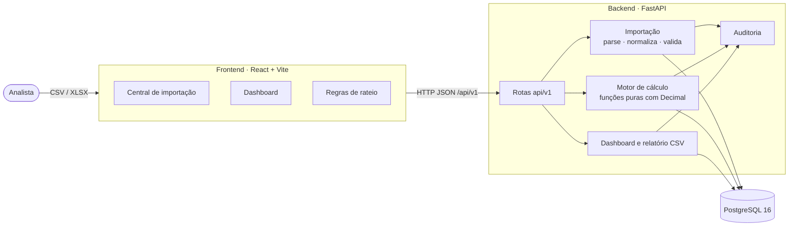
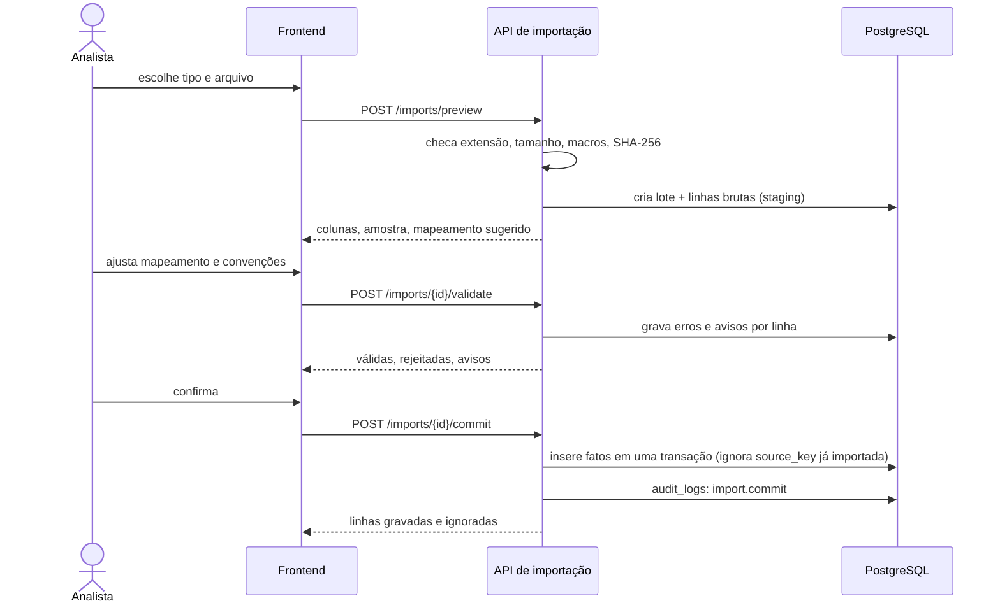
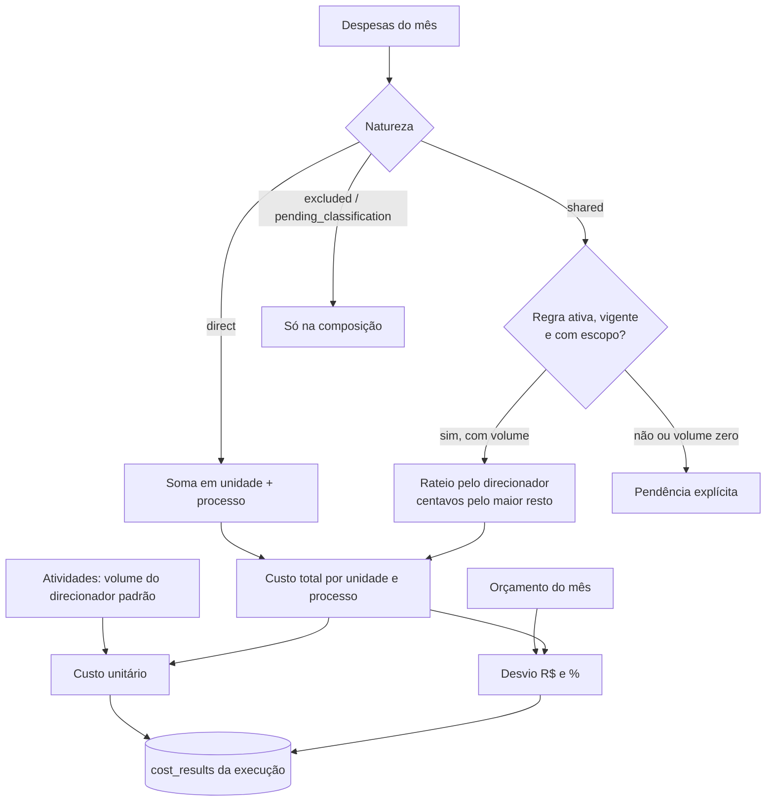
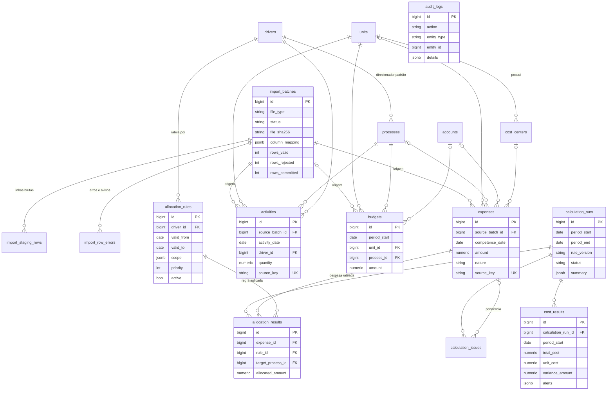

# Arquitetura

O LogiCost Intelligence é um **monólito modular**: um backend FastAPI com as regras de negócio, um banco PostgreSQL e um frontend React que só exibe o que a API calcula. Os diagramas abaixo usam [Mermaid](https://mermaid.js.org/), que o GitHub desenha direto na página.

## Visão geral

| Camada | Pasta | Responsabilidade |
| --- | --- | --- |
| Rotas | `backend/app/api/v1/` | Validam a entrada (Pydantic), chamam o serviço e devolvem o contrato JSON. Não têm regra de negócio. |
| Serviços | `backend/app/services/` | Importação, cálculo, regras de rateio, dashboard e auditoria. |
| Motor de cálculo | `services/calculations.py` e `services/calculation_engine.py` | Funções puras (sem banco) para custo unitário, desvio, rateio e cálculo do mês. Toda a matemática é testada sem infraestrutura. |
| Modelos | `backend/app/models/` | Tabelas do ORM (SQLAlchemy 2). O esquema evolui só por migrations do Alembic. |
| Frontend | `frontend/src/` | Telas, filtros e gráficos. Não recalcula indicadores. Formata valores em pt-BR. |

## Fluxo de importação

Nada vai para as tabelas finais antes da confirmação. As linhas brutas ficam em staging e o lote guarda o mapeamento e as convenções usadas, para que a validação possa ser repetida e auditada.

## Fluxo de cálculo

Cada execução grava a `rule_version` (hash das regras ativas). Recalcular cria uma nova execução sem apagar a anterior. Uma execução antiga só vira `superseded` quando a nova cobre todos os meses dela; o dashboard usa, em cada mês, a execução mais recente que cobre aquele mês.

## Modelo entidade-relacionamento

`audit_logs` não tem chave estrangeira de propósito: registra `entity_type` + `entity_id` de qualquer entidade e continua válido mesmo se a entidade for desativada. As colunas completas de cada tabela estão no [dicionário de dados](dicionario-de-dados.md).

## Decisões técnicas

| Tema | Decisão | Por quê |
| --- | --- | --- |
| Dinheiro | `Decimal` no Python, `NUMERIC(14,2)` no banco e texto decimal na API | `float` acumula erro de arredondamento; R$ 0,01 de diferença já quebra a conferência. |
| Centavos do rateio | Maior resto | A soma rateada sempre fecha com o valor da despesa original. |
| Duplicidade | `source_key` única por fonte; orçamento por período + unidade + processo + conta | Reimportar o mesmo arquivo é seguro; o hash do arquivo ajuda, mas não basta. |
| Convenções de data e número | Escolhidas pelo usuário (`iso`/`dmy`, `.`/`,`) | `01/02/2026` é ambíguo. O que não se encaixa vira erro em vez de ser adivinhado. |
| Custo unitário | Só com um único direcionador no recorte | Custo por palete e por pedido não se somam; com mistura, a API devolve N/D e `MIXED_DRIVERS`. |
| Cálculo | Sempre para todas as unidades do período; filtros só nas consultas | Uma execução é um retrato completo e reprodutível do mês. |
| Histórico | Execuções nunca são apagadas | Qualquer número do dashboard pode ser rastreado até a execução, a regra e o lote de origem. |
